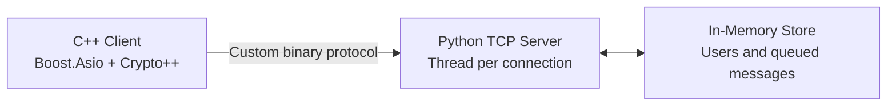

# MessageU

A secure messaging application built with a C++ client and Python server.

Built for an Open University Defensive Systems Programming course. The project includes the full client and server implementation.

## Overview

MessageU implements a course-specified binary protocol for client registration, user discovery, key exchange, encrypted messaging, and message retrieval.

## Technical Highlights

- C++ client using Boost.Asio for TCP communication.
- Python server handling concurrent client connections.
- RSA public-key cryptography for key exchange.
- AES encryption for message content.
- Custom binary protocol implemented on both client and server.
- Thread-safe in-memory storage for registered users and queued messages.

## Architecture

| Component | Responsibility |
| --- | --- |
| `client/Client.cpp` | Client workflow, networking, and user interaction |
| `client/Protocol.cpp` | Binary request serialization and response parsing |
| `client/AESWrapper.cpp` | AES encryption and decryption |
| `client/RSAWrapper.cpp` | RSA key generation, encryption, and decryption |
| `server/Server.py` | TCP server and request handling |
| `server/Protocol.py` | Protocol parsing, validation, and response serialization |
| `server/DataBase.py` | Thread-safe user and message storage |

## Dependencies

- C++17
- Boost
- Crypto++
- Python 3.10+
